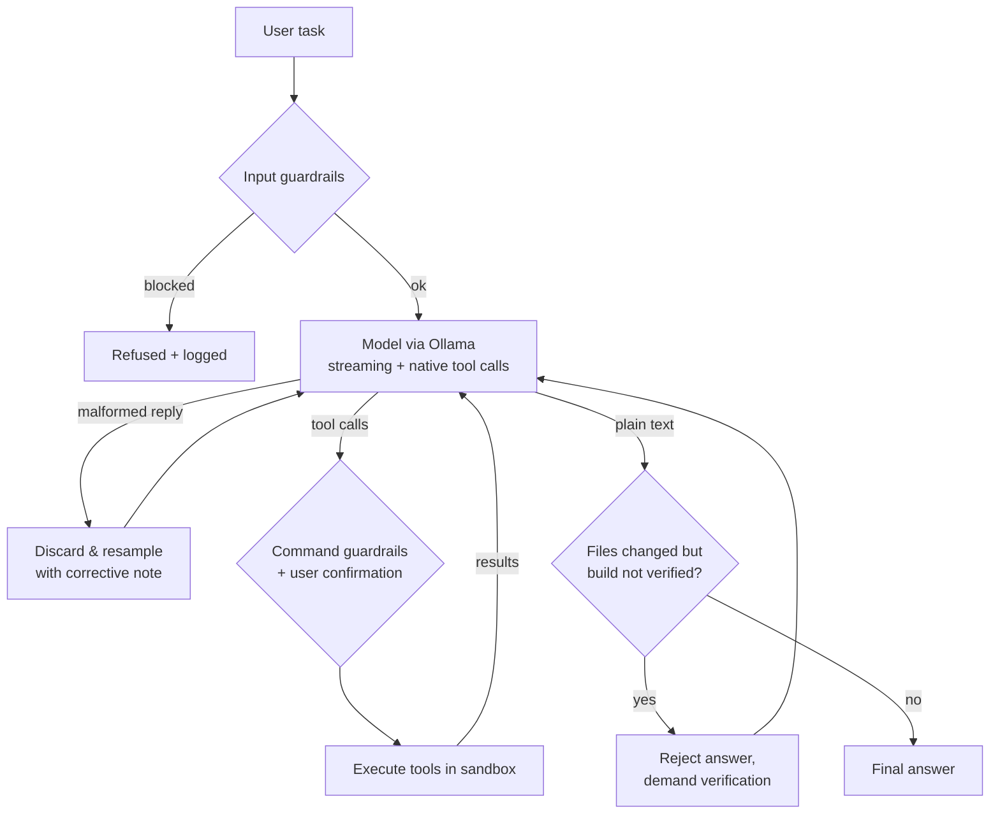

# C# Coding Agent

A terminal coding agent that runs entirely on **local LLMs** via [Ollama](https://ollama.com), [Embla](https://github.com/sevren-ai/embla-metal) or any OpenAI-compatible server (mlx_lm, …) — built from scratch in C# / .NET 8, with no agent framework. Point it at a project folder, give it a task, and it explores the code, edits files, runs the build, and iterates until the work is done and verified.

The interesting part isn't the loop itself — it's everything needed to make *small local models* reliable inside that loop: malformed-reply recovery, fuzzy edit matching, context-window management, layered guardrails, and enforced build verification. Those are documented in [Design decisions](#design-decisions) below.

<!-- TODO: record a short demo (e.g. with asciinema or a GIF) and embed it here -->

## Features

- **Agentic loop** with native Ollama tool calling: `list_files`, `read_file`, `search_files`, `write_file`, `edit_file`, `run_command`, `ask_user`
- **Plan mode** (`plan <task>` → review → `go`): the model gets read-only tools and must present a plan before it may change anything
- **Enforced verification**: after any file change, a final answer is rejected until the project's build/test command (`dotnet test` / `dotnet build`, auto-detected) has passed
- **Sandboxed**: all file access is confined to the chosen working folder, including symlink-escape protection; every shell command and file overwrite needs explicit user confirmation
- **Layered guardrails**: regex rails screen user input (prompt injection, destructive intent, secrets exfiltration) and model-proposed commands (`rm -rf /`, fork bombs, `curl | sh`, …) before confirmation is even offered
- **Context management** that survives long sessions on small context windows
- **Structured logging** (Serilog → human-readable `.log` + machine-queryable `.clef`), with every task's events tagged by a task id

## How it works



| Component | Responsibility |
|---|---|
| `Agent/CodingAgent.cs` | The loop: stream the reply, execute tool calls, detect malformed output, enforce verification, inject progress reminders |
| `Agent/ConversationHistory.cs` | Transcript trimming within a token-derived character budget |
| `Tools/AgentTools.cs` | Tool implementations, path sandboxing, confirmation prompts, fuzzy edit matching |
| `Tools/ProjectOrientation.cs` | Project layout + key config files appended to the system prompt, so the model doesn't rediscover the stack every task |
| `Tools/ProjectVerification.cs` | Detects the project's verification command (`dotnet test` / `dotnet build`) |
| `Guardrails/GuardrailPipeline.cs` | Named regex rails for user input and model-proposed shell commands |
| `Llm/ChatModels.cs` | Backend-neutral message models, the `IChatClient` interface, and the list of selectable model servers |
| `Ollama/OllamaClient.cs` | Minimal streaming HTTP client for `/api/chat` with native tool calling |
| `OpenAi/OpenAiClient.cs` | Streaming SSE client for OpenAI-compatible `/v1/chat/completions` (Embla, mlx_lm, …) |

## Design decisions

Most of this project is engineering around how small local models actually behave — the failure modes below all came from real sessions.

### Small models produce broken tool calls — plan for it

Different models fail in different ways: some write tool-call syntax as literal text (`<tool_call>…</tool_call>`) instead of using native tool calling, some leak chat-template control tokens (`<|channel|>` — sometimes degraded to `<channel|>` because Ollama's parser eats part of the token before giving up), and some produce output Ollama's own parser rejects mid-stream. Treating any of these as a final answer strands the task half-done. The agent detects all three shapes, discards the reply, injects one corrective note, and resamples — up to three *consecutive* failures before giving up (any good reply resets the count).

### Edits fail on details, so `edit_file` is forgiving in safe ways

Models paste `read_file`'s line-number prefixes into their find/replace text, or reproduce a snippet with the wrong indentation. Rather than dead-ending, `edit_file` strips line-number prefixes and falls back to a whitespace-relaxed line match — but the match must still be **unique**, and the replacement is re-indented to what the file really uses. Similarly, `write_file` rejects whole-file rewrites that are ≥80% identical to the existing file (a classic way models truncate files) and redirects them to `edit_file`.

### Context budgets must be measured, not guessed

The transcript is trimmed to ~80% of the context window using a chars-per-token estimate, because overflowing `num_ctx` makes Ollama silently drop the *oldest* part of the prompt — usually the system prompt. The initial ~4 chars/token guess overshoots for code-heavy text, so the budget is recalibrated from the real token counts Ollama reports — but only ratcheted *down*, because warm-cache requests under-report prompt tokens and would inflate the estimate. Trimmed tool results are replaced with a placeholder that names the tool *and its subject* (`[older read_file result for 'src/App.cs' removed …]`), so the model re-reads the file instead of editing from memory.

### Long tasks need periodic re-anchoring

After a wall of tool traffic, small models drift off-task or forget what remains. Every 8 steps the agent re-injects the original task plus a recap of what was actually done (built from recorded tool calls, not the model's claims), explicitly marked as automated so it isn't mistaken for new user instructions.

### "Done" means verified, not claimed

File changes taint the session as *unverified*; only a passing run of the detected verification command clears the flag. A final answer while unverified is sent back with orders to build/test first — but only twice, then it's accepted with a visible warning, because a hard block ping-pongs forever with a model that can't get the build green.

### Safety comes in layers, and no single layer is the story

Regex guardrails are the cheap, instant first line — they catch obvious prompt injection and destructive requests, but a determined user can always rephrase. So the dangerous actions themselves are *also* gated: every shell command and file overwrite requires interactive confirmation (with opt-in session-scoped approval per command program — commands containing shell operators like `;`, `|`, `$()` never qualify for blanket approval), file access is path-checked *and* symlink-checked against the working folder, and known-catastrophic commands are refused before the user is even asked — confirmation prompts get clicked through on autopilot.

### Model notes

Observed with this agent's tool-calling workload:

| Model | Behavior |
|---|---|
| `gemma4:12b-mlx` | Most reliable native tool calling; the default |
| `qwen3.5` | Trips Ollama's tool-call parser (XML syntax errors mid-stream) |
| `qwen2.5-coder` | Fakes tool calls as plain text instead of native calls |
| `gpt-oss` | Leaks (sometimes degraded) control tokens like `<channel\|>` |

The recovery mechanisms above exist precisely because of this spread.

## Getting started

Prerequisites:

- [.NET 8 SDK](https://dotnet.microsoft.com/download/dotnet/8.0)
- A local model server, one of:
  - [Ollama](https://ollama.com), with a model that supports **native tool calling** installed (e.g. `ollama pull qwen2.5:14b` — or any tool-capable model you prefer)
  - [Embla](https://github.com/sevren-ai/embla-metal) (Apple silicon, macOS 15+): `swift run -c release embla download`, then `swift run -c release embla serve` — it listens on `127.0.0.1:8080` with a 32k context by default (`--context` to change it; give the agent the same value)
  - `mlx_lm.server` on `localhost:8080`

```bash
dotnet run --project src/CodeAgent
```

The agent asks for a working folder (it will only read/write inside it), a model server (`ollama`, `embla` or `mlx`), a model, and a context window size, then drops you into a REPL:

```
<task>          give the agent a coding task
plan <task>     investigate and propose a plan without changing files
go              execute the approved plan
model <name>    list installed models / switch model (history is kept)
clear           reset the conversation
exit            quit
```

## Tests

```bash
# Unit tests (no external dependencies)
dotnet test --filter "FullyQualifiedName!~OllamaIntegrationTests"

# Full suite — requires a running Ollama with a tool-calling model installed
CODEAGENT_TEST_MODEL=<model> dotnet test
```

CI runs the unit tests on every push and pull request.

## License

[MIT](LICENSE)
